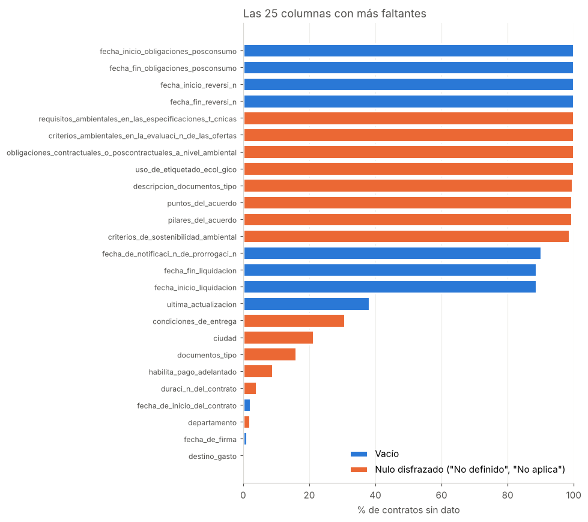

# Data quality assessment: SECOP II public contracts

[English](#english) · [Español](#español)

---

## English

**Status: in progress.** This README describes the plan. Results will be added as each phase is finished.

**Goal.** Measure the quality of a real, messy public dataset across standard data quality dimensions, combine the results into a DQ Score, and propose a phased improvement plan, the same way a data quality programme would run inside an organisation.

### Data

- **Source:** [SECOP II - Contratos Electrónicos](https://www.datos.gov.co/Estad-sticas-Nacionales/SECOP-II-Contratos-Electr-nicos/jbjy-vk9h) (dataset `jbjy-vk9h`), published by Colombia Compra Eficiente on datos.gov.co.
- **Licence:** [CC BY-SA 4.0](https://creativecommons.org/licenses/by-sa/4.0/). Any data derived from it in this folder is shared under the same licence.
- **Size:** about 5.7 million contracts and 95 columns.
- **Snapshot:** `data/secop2_contratos_2026-10-27_50000.parquet`, 50,000 contracts downloaded on 27 Oct 2026. The source reloads the whole dataset every day (every row gets a new internal id and contract values keep changing), so the API cannot return the same sample twice. The frozen Parquet is what makes the results reproducible; `id_contrato` lets you look up the same contracts again later.
- **Personal data:** 18 columns about people (legal representative, spending and payment officers, supervisor, bank account) are replaced by a `<column>_informado` true/false flag. When the supplier is a person rather than a company (85% of the sample), the name is removed and the ID number is replaced by a pseudonym (salted HMAC), keeping its length and whether it is digits only. Free-text fields such as `objeto_del_contrato` are kept as published and may still mention names.

### Approach

| Phase | Output | Content |
|---|---|---|
| 1. Profiling ✅ | [`notebooks/01_perfilado.ipynb`](notebooks/01_perfilado.ipynb) | Types, nulls, cardinality, ranges and distributions |
| 2. Rules by dimension 🔄 | [`src/reglas_dq.py`](src/reglas_dq.py), [`outputs/02_resultado_reglas.csv`](outputs/02_resultado_reglas.csv) | 25 rules across completeness, validity, consistency, uniqueness, accuracy and timeliness, with unit tests; thresholds under review |
| 3. DQ Score | `notebooks/02_dq_score.ipynb` | Score per rule, per dimension and overall, with weights and thresholds |
| 4. Improvement plan | This README | Quick wins, medium-term and structural actions with target KPIs |


### Profiling findings (phase 1)

- 30 of 77 source columns have missing data; in 20 of them it is disguised as text ("No definido", "No aplica"), which a plain null count misses.
- 12 columns are dead: 4 dates are always empty and 8 environmental, peace-agreement and document-type fields are over 98% "No aplica".
- `ultima_actualizacion` is missing for 38% of contracts, so timeliness can barely be measured.
- 364 contracts are worth 0 and 26 are worth under 1,000 pesos (mostly exactly 1 peso): placeholder values.
- 1,820 contracts (3.6%) start before they were signed; 29 have more paid than the contract value.
- 68 citizen ID numbers have 11 or more digits (valid ones have 6 to 10) and 5 contracts were awarded to a minor's ID card (Tarjeta de Identidad).



### Reproduce

The analysis reads the Parquet in `data/`. To build a new snapshot from the live source:

```bash
pip install pandas pyarrow matplotlib pytest
python src/descargar_snapshot.py --filas 50000
python src/construir_parquet.py data/secop2_contratos_<fecha>_50000.csv
```

To run the quality rules and their tests on the snapshot:

```bash
python src/reglas_dq.py
python -m pytest tests
```

### How I worked

I built this project with the help of an AI assistant (Claude). The scope, the privacy treatment, the rules, the thresholds and the conclusions are my decisions.

---

## Español

**Estado: en curso.** Este README describe el plan. Los resultados se agregan al cerrar cada fase.

**Objetivo.** Medir la calidad de un dataset público real y desordenado según las dimensiones estándar de calidad del dato, consolidar el resultado en un DQ Score y proponer un plan de mejora por fases, como se haría en un programa de calidad del dato dentro de una organización.

### Datos

- **Fuente:** [SECOP II - Contratos Electrónicos](https://www.datos.gov.co/Estad-sticas-Nacionales/SECOP-II-Contratos-Electr-nicos/jbjy-vk9h) (dataset `jbjy-vk9h`), publicado por Colombia Compra Eficiente en datos.gov.co.
- **Licencia:** [CC BY-SA 4.0](https://creativecommons.org/licenses/by-sa/4.0/). Los datos derivados en esta carpeta se comparten bajo la misma licencia.
- **Tamaño:** cerca de 5,7 millones de contratos y 95 columnas.
- **Snapshot:** `data/secop2_contratos_2026-10-27_50000.parquet`, 50.000 contratos descargados el 27 de octubre de 2026. La fuente recarga el dataset completo cada día (cada fila recibe un id interno nuevo y los valores de los contratos siguen cambiando), así que la API no puede devolver dos veces la misma muestra. El Parquet congelado es lo que hace reproducibles los resultados; `id_contrato` permite volver a consultar los mismos contratos más adelante.
- **Datos personales:** 18 columnas sobre personas (representante legal, ordenadores del gasto y del pago, supervisor, cuenta bancaria) se reemplazan por una bandera `<columna>_informado` verdadero/falso. Cuando el proveedor es una persona y no una empresa (85 % de la muestra), se elimina el nombre y el documento se reemplaza por un seudónimo (HMAC con sal), conservando su longitud y si es solo dígitos. Los campos de texto libre como `objeto_del_contrato` se dejan como se publicaron y pueden mencionar nombres.

### Enfoque

| Fase | Entregable | Contenido |
|---|---|---|
| 1. Perfilado ✅ | [`notebooks/01_perfilado.ipynb`](notebooks/01_perfilado.ipynb) | Tipos, nulos, cardinalidad, rangos y distribuciones |
| 2. Reglas por dimensión 🔄 | [`src/reglas_dq.py`](src/reglas_dq.py), [`outputs/02_resultado_reglas.csv`](outputs/02_resultado_reglas.csv) | 25 reglas de completitud, validez, consistencia, unicidad, exactitud y oportunidad, con pruebas unitarias; umbrales en revisión |
| 3. DQ Score | `notebooks/02_dq_score.ipynb` | Puntaje por regla, por dimensión y global, con pesos y umbrales |
| 4. Plan de mejora | Este README | Acciones rápidas, de mediano plazo y estructurales, con KPI objetivo |


### Hallazgos del perfilado (fase 1)

- 30 de las 77 columnas de la fuente tienen faltantes; en 20 de ellas vienen disfrazados de texto ("No definido", "No aplica"), que un conteo de nulos normal no detecta.
- 12 columnas están muertas: 4 fechas siempre vacías y 8 campos ambientales, del acuerdo de paz y de documentos tipo con más del 98 % en "No aplica".
- `ultima_actualizacion` falta en el 38 % de los contratos, así que la oportunidad casi no se puede medir.
- 364 contratos valen 0 y 26 valen menos de 1.000 pesos (la mayoría exactamente 1 peso): valores de relleno.
- 1.820 contratos (3,6 %) empiezan antes de firmarse; 29 tienen pagado más que el valor del contrato.
- 68 cédulas tienen 11 dígitos o más (las válidas tienen de 6 a 10) y 5 contratos se adjudicaron a una Tarjeta de Identidad, documento de menores de edad.


### Reproducir

El análisis lee el Parquet de `data/`. Para generar un snapshot nuevo desde la fuente:

```bash
pip install pandas pyarrow matplotlib pytest
python src/descargar_snapshot.py --filas 50000
python src/construir_parquet.py data/secop2_contratos_<fecha>_50000.csv
```

Para ejecutar las reglas de calidad y sus pruebas sobre el snapshot:

```bash
python src/reglas_dq.py
python -m pytest tests
```

### Cómo trabajé

Desarrollé este proyecto con la asistencia de una IA (Claude). El alcance, el tratamiento de la privacidad, las reglas, los umbrales y las conclusiones son decisiones mías.
